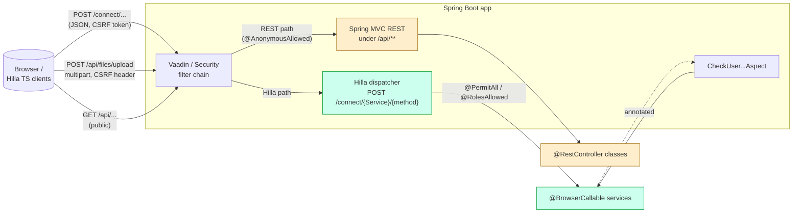

# Hilla services & REST endpoints

## Purpose

Catalogue every server-side surface exposed to the browser, distinguish the
two transport mechanisms (Vaadin Hilla RPC vs. plain Spring MVC REST), and
document the auth annotations that gate each service.

## Contents

- [Diagram — server surface, two channels](#diagram--server-surface-two-channels)
- [Narrative](#narrative)
  - [Two transports, one filter chain](#two-transports-one-filter-chain)
  - [Hilla service catalogue](#hilla-service-catalogue)
  - [Generic CRUD bases](#generic-crud-bases)
  - [Hand-written REST controllers](#hand-written-rest-controllers)
  - [WebSocket — third channel](#websocket--third-channel)
  - [Worked example — saving a `Sample`](#worked-example--saving-a-sample)
- [Where to look in the code](#where-to-look-in-the-code)
- [The REST surface — complete list](#the-rest-surface--complete-list)
- [`ControllerEndpoint` is a hardware input, not a stub](#controllerendpoint-is-a-hardware-input-not-a-stub)

## Diagram — server surface, two channels

## Narrative

### Two transports, one filter chain

* **Hilla RPC.** Java methods on a `@BrowserCallable` class are auto-mapped to
  `POST /connect/{ServiceName}/{methodName}`. Vaadin generates TypeScript
  stubs into `src/main/frontend/generated/`, so the call site is
  `import { list, save } from 'Frontend/generated/SampleService'` (one TS file
  per service). The connect client adds the CSRF / session token, serialises
  arguments to JSON, and propagates `@RolesAllowed` failures as exceptions on
  the TS side.
* **Spring MVC REST.** Three `@RestController` classes serve under
  `/api/**`. They are excluded from Vaadin routing
  (`vaadin.exclude-urls=/api/**` in `cms/src/main/resources/application.properties:18`)
  and treated as anonymous by the security filter
  (`cms/src/main/java/ch/rupfizupfi/deck/security/SecurityConfiguration.java:42-49`).

### Hilla service catalogue

All services live under the same package on each module
(`ch.rupfizupfi.deck.api.services`). The cms module exposes 11 services; the
command-deck module adds 3 hardware services. Most have no Java body beyond
the generic CRUD base.

| Service | Module | Auth | Base | Notes |
|---|---|---|---|---|
| `CustomerService` | cms | `@PermitAll` | `CrudRepositoryServiceForOwnerData<Customer, ...>` | owner-filtered list/get/delete; `save` refuses an owner on a customer a shared project references |
| `ProjectService` | cms | `@PermitAll` | `CrudRepositoryServiceForOwnerData<Project, ...>` | owner-filtered list/get/delete; `save` refuses a shared project on an owned customer |
| `SampleService` | cms | `@PermitAll` | `CrudRepositoryServiceForOwnerData<Sample, ...>` | owner-filtered list/get/delete |
| `TestParameterService` | cms | `@PermitAll` | `CrudRepositoryServiceForOwnerData<TestParameter, ...>` | owner-filtered list/get/delete; `save` refuses an executable parameter outside the [rig limits](persistence-model.md#rig-limits) with an `EndpointException` |
| `TestResultService` | cms | `@PermitAll` | `CrudRepositoryServiceForOwnerData<TestResult, ...>` | adds `listCSVResults`, `readCSVData`, both gated on the scoped `get` |
| `MaterialService` | cms | `@PermitAll` | `CrudRepositoryService<Material, ...>` | reference data |
| `GearTypeService` | cms | `@PermitAll` | `CrudRepositoryService<GearType, ...>` | reference data |
| `GearStandardService` | cms | `@PermitAll` | `CrudRepositoryService<GearStandard, ...>` | reference data |
| `FileMetadataService` | cms | `@PermitAll` | `CrudRepositoryService<FileMetadata, ...>` | metadata only — bytes via `/api/files/...`; `connectToTestResult` re-parents only a stored row the caller may access |
| `UserService` | cms | `@RolesAllowed("ADMIN")` | `CrudRepositoryService<User, ...>` | overrides `save`/`saveAll` to bcrypt `newPassword`; an edit without one keeps the stored hash, a new user without one is refused |
| `SettingService` | cms | `@RolesAllowed("ADMIN")` | implements `CrudService` directly | file-backed settings (no JPA); `list` filters, sorts and pages in memory; `save` validates key, type, directory and rig-limit range |
| `TestRunnerService` | command-deck | `@PermitAll` | — | exposes `start(testId: Long)`, `status()`, `stop()`, `resume()`, `abort()` |
| `DeviceInfoService` | command-deck | `@PermitAll` | — | per-client holds on the info broadcaster (first starts, last stops) |
| `SuckService` | command-deck | `@PermitAll` | — | toggles 4-way relay |

One more browser-callable surface sits outside that package and outside the
table: `UserEndpoint`
(`cms/src/main/java/ch/rupfizupfi/deck/api/UserEndpoint.java:22`) is annotated
with the older `@Endpoint` rather than `@BrowserCallable`, and is
`@AnonymousAllowed` because `useAuth()` must be able to ask who is signed in
*before* anyone is. It exposes `getAuthenticatedUser()` and an admin-filtered
`list(Pageable, Filter)`.

`@PermitAll` on Hilla means "any authenticated user"; anonymous calls need
`@AnonymousAllowed` or a `permitAll()` URL in `SecurityConfiguration`.

### Generic CRUD bases

* `CrudRepositoryService<T, R>`
  (`cms/src/main/java/ch/rupfizupfi/deck/hilla/crud/CrudRepositoryService.java:6`)
  extends Hilla's `com.vaadin.hilla.crud.CrudRepositoryService` and exposes `getCrudRepository()` so the AOP aspect can resolve a repository
  from a CRUD service join-point target.
* `CrudRepositoryServiceForOwnerData<T extends DataWithOwner, R>`
  (`cms/.../hilla/crud/CrudRepositoryServiceForOwnerData.java:24`) — the
  owner-aware subclass detailed in
  [`security-and-tenancy.md`](security-and-tenancy.md). It overrides `get`,
  `list`, `delete` to AND an `owner = currentUser OR owner IS NULL`
  specification, and `save`/`saveAll` to hold a write to the same rule.
* Every `list` (both bases, `FileMetadataService`, `SettingService`,
  `UserEndpoint`) passes the client's `Pageable` through `PageCap.clamp`
  (`cms/.../hilla/crud/PageCap.java`): at most 500 rows a page, page number and
  sort kept, an unpaged request served as the first 500.
* Every `save`/`saveAll` on either base first runs `ToOneReferences.normalize`:
  an id-less `@ManyToOne`/`@OneToOne` (a form's untouched empty value) becomes
  null, and a null one mapped `optional = false` (a project's customer, a
  sample's project) is an `EndpointValidationException` on that field, not a
  `TransientPropertyValueException` 500. A batch is checked before any row is written.

The entity ID type is `Long` everywhere.

### Hand-written REST controllers

Three classes in `cms/src/main/java/ch/rupfizupfi/deck/api/rest/`; paths in
[the complete list](#the-rest-surface--complete-list). The REST surface exists because:

1. Hilla doesn't natively handle multipart upload (`FileEndpoint`).
2. Bulk file download with custom HTTP headers is awkward through Hilla
   (`DownloadResults`).
3. `ControllerEndpoint` is called by hardware that cannot speak Hilla RPC.

`SecurityConfiguration` decides per path — `ControllerEndpoint` anonymous,
the file and download controllers authenticated — so the per-class
`@AnonymousAllowed` (`ControllerEndpoint`, `FileEndpoint`) / `@PermitAll`
(`DownloadResults`) annotations document rather than enforce. See [`security-and-tenancy.md`](security-and-tenancy.md).

### WebSocket — third channel

Real-time streaming uses STOMP-over-WebSocket, configured by
`WebSocketConfig` (`cms/src/main/java/ch/rupfizupfi/deck/messaging/WebSocketConfig.java:12`):

* `enableSimpleBroker("/topic")`
* `setApplicationDestinationPrefixes("/app")`
* Endpoint: `/status`
* Client inbound channel: `BrokerInboundGuard` — SUBSCRIBE under `/topic/` only, every SEND refused

Producers: `ForceBroadcaster`, `DeviceInfoBroadcaster`, `TestLogger.log`
(`/topic/logs`). Consumers: React components via `@stomp/rx-stomp`. See
[`hardware-integration.md`](hardware-integration.md) for the topic list.

WebSocket auth piggy-backs on the HTTP session — the STOMP CONNECT happens
over the same Vaadin-protected origin, and the handshake's principal becomes the
STOMP session user that `BrokerInboundGuard` checks. See
[`security-and-tenancy.md`](security-and-tenancy.md).

### Worked example — saving a `Sample`

1. Frontend calls `SampleService.save(sample)` from
   `Frontend/generated/SampleService.ts`.
2. Hilla connect-client posts JSON to `/connect/SampleService/save` with the
   session token.
3. The Vaadin filter chain validates the session, then the Hilla dispatcher
   resolves `SampleService.save` and reflects it.
4. `CrudRepositoryServiceForOwnerData.save` scopes the write: a non-null
   `sample.owner` other than the caller, or an id the scoped `get` does not
   resolve, throws `SecurityException`.
5. The (inherited) `save` method on `CrudRepositoryService` saves via
   `SampleRepository`.
6. The persisted `Sample` is JSON-serialised back; `OwnerSerializer` collapses
   the owner relationship to a `{id, name}` stub to avoid leaking other
   users' details.

## Where to look in the code

| Concern | File |
|---|---|
| Hilla services | `cms/src/main/java/ch/rupfizupfi/deck/api/services/` (11 files) and `command-deck/src/main/java/ch/rupfizupfi/deck/api/services/` (3 files) |
| Generic CRUD base | `cms/src/main/java/ch/rupfizupfi/deck/hilla/crud/CrudRepositoryService.java` |
| Owner-aware CRUD | `cms/src/main/java/ch/rupfizupfi/deck/hilla/crud/CrudRepositoryServiceForOwnerData.java:17` |
| REST controllers | `cms/src/main/java/ch/rupfizupfi/deck/api/rest/{ControllerEndpoint,FileEndpoint,DownloadResults}.java` |
| Generated TS clients | `cms/src/main/frontend/generated/*Service.ts` and `command-deck/src/main/frontend/generated/{TestRunnerService,DeviceInfoService,SuckService}.ts` |
| Vaadin URL exclusion | `cms/src/main/resources/application.properties:18` (`vaadin.exclude-urls=/api/**`) |
| WebSocket config | `cms/src/main/java/ch/rupfizupfi/deck/messaging/WebSocketConfig.java:12` |

## The REST surface — complete list

Three `@RestController` classes, all in
`cms/src/main/java/ch/rupfizupfi/deck/api/rest/`, all under `/api/**`; only
`ControllerEndpoint` is anonymous (see
[`security-and-tenancy.md`](security-and-tenancy.md)):

| Method + path | Class | Purpose |
|---|---|---|
| `POST /api/files/upload` | `FileEndpoint` | Single-file upload → `FileMetadata`; the only upload endpoint. Needs the CSRF header, which `<vaadin-upload>` sends via `util/csrf.ts` ([security](security-and-tenancy.md#csrf-cors-multipart)). An upload that cannot be stored leaves no `FileMetadata` row. Bytes are stored as `<id>.<ext>`; the client's name is kept only as `fileName`. |
| `GET /api/files/image/{fileName}` | `FileEndpoint` | Serve an uploaded image; 404 unless a `FileMetadata` row stores that name, the caller may read it (`FileMetadataService.findReadable`) and its bytes exist. |
| `GET /api/DownloadEndpoint/project/{projectId}` | `DownloadResults` | XLSX export of a project's results via Apache POI (`projectId` constrained to digits); 404 for a project the owner-scoped `ProjectService.get` does not resolve; a non-admin's rows are owner-scoped too, so a shared project exports only own and unowned results. The "Peaks (kN)" column carries the peak of every force CSV in each result directory, whatever the age of the run. |
| `GET /api/ControllerEndpoint/press/{button}` | `ControllerEndpoint` | Physical button box input — see below. |

`vaadin.exclude-urls=/api/**` in `application.properties` keeps these
paths out of Vaadin's routing.

## `ControllerEndpoint` is a hardware input, not a stub

`GET /api/ControllerEndpoint/press/{button}` logs the button name and echoes
it back. Nothing in this repository invokes it, but a **physical button box
wired to the tester** does.

Do not delete it or move it behind authentication — it is the one anonymous
`/api` path, see [`security-and-tenancy.md`](security-and-tenancy.md). The button box's
firmware, wiring and per-`{button}` semantics are undocumented; the endpoint
only logs, so no behaviour depends on them.
