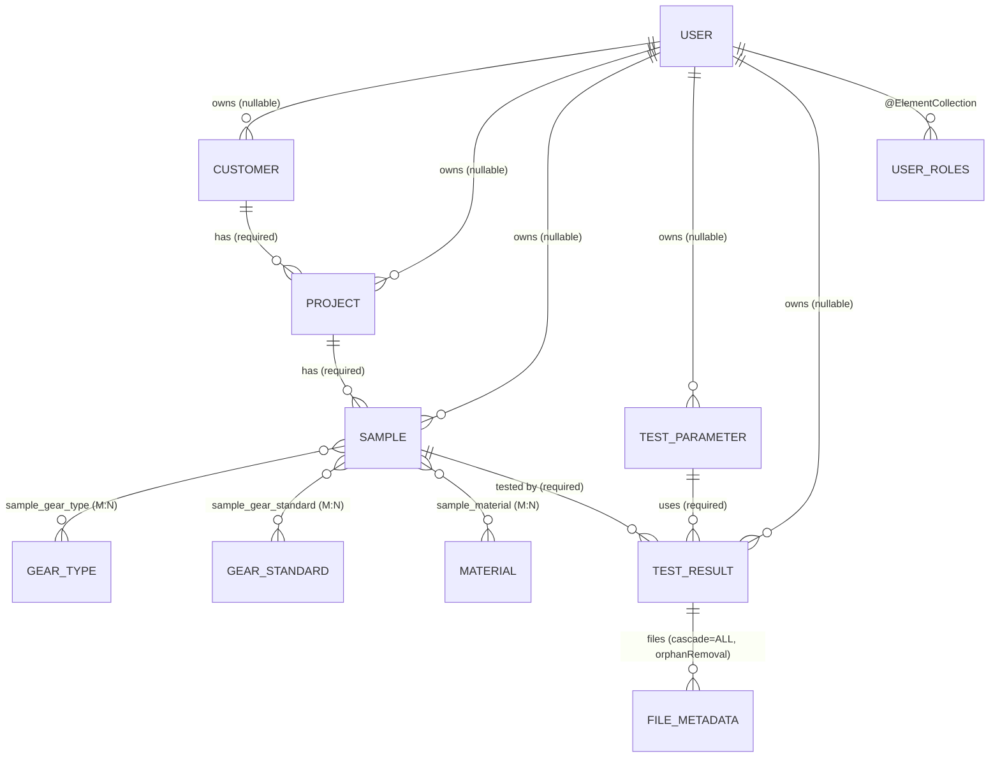

# Persistence model

## Purpose

Catalogue every JPA entity, its key columns, and its relationships, so a new
engineer can read a `TestResult` and follow the chain back to a `Customer`
without opening ten Java files.

All entities live in `:cms` (`cms/src/main/java/ch/rupfizupfi/deck/data/`).
The `:command-deck` module declares **no** `@Entity` of its own; it picks up
the cms data classes through `implementation project(':cms')` and the shared
scan root ([`spring-boot-setup.md`](../modules/spring-boot-setup.md)).

## Contents

- [Diagram](#diagram)
- [Narrative](#narrative)
  - [Common base class](#common-base-class)
  - [Domain shape](#domain-shape)
  - [Reference data (no owner)](#reference-data-no-owner)
  - [`Setting` is *not* a JPA entity](#setting-is-not-a-jpa-entity)
    - [Rig limits](#rig-limits)
  - [Ownership marker](#ownership-marker)
  - [Schema and seed data](#schema-and-seed-data)
- [Where to look in the code](#where-to-look-in-the-code)
- [`TestParameter.type` is an enum](#testparametertype-is-an-enum)
- [Known limits](#known-limits)

## Diagram



Source: [`doc/diagrams/src/er-diagram.mmd`](../../diagrams/src/er-diagram.mmd).

## Narrative

### Common base class

Every entity extends `AbstractEntity`
(`cms/src/main/java/ch/rupfizupfi/deck/data/AbstractEntity.java:7`):

* `@Id @GeneratedValue(IDENTITY)` — `Long id`.
* `@Version int version`.
* `equals` / `hashCode` keyed on `id` (or fall through if the row is transient).

There is no shared `@CreatedDate` / `@UpdatedDate` auditing.

The `owner` and parent links are `EAGER` (bar `TestResult.owner`) and
`User.roles` is an eager collection, so both modules set
`hibernate.default_batch_fetch_size=50`: a 20-row grid page costs 3–4
statements instead of 41–61 (B-16, `EagerGraphQueryCountTest`).

### Domain shape

The data flow is a funnel:

```
Customer -> Project -> Sample -> TestResult <- TestParameter
                                       └── FileMetadata*
```

* **`Customer`** (`Customer.java`) — CRM record (organization,
  firstname, lastname, email + Swiss postal code regex `^\d{4,5}$`), owned by
  an optional `User`. Implements `DataWithOwner` (since `V4__customer_owner`);
  a shared project may only reference a shared customer.
* **`Project`** (`Project.java:12`) — owned by an optional `User`, references
  exactly one `Customer` (`optional=false`). Implements `DataWithOwner`.
* **`Sample`** (`Sample.java:17`) — physical specimen under test. Owned by
  optional `User`, belongs to one `Project`, joined many-to-many to
  `GearType`, `GearStandard`, `Material` via the join tables
  `sample_gear_type`, `sample_gear_standard`, `sample_material`.
* **`TestParameter`** (`TestParameter.java:13`) — reusable recipe (`type` is
  the `TestType` enum: `DESTRUCTIVE`, `CYCLIC`, `TIME_CYCLIC`). Holds limits,
  ramp times, cycle count.
* **`TestResult`** (`TestResult.java:15`) — the actual test run. Joins one
  `Sample` and one `TestParameter`, owns a `List<FileMetadata>` with
  `cascade=ALL` + `orphanRemoval=true` (deleting a `TestResult` deletes its
  `FileMetadata` rows, not the files on disk, which belong to
  `CSVStoreService` / `StorageLocationService`, see
  [`hardware-integration.md`](hardware-integration.md)).
* **`FileMetadata`** (`FileMetadata.java:9`) — file pointer; the bytes live on
  the host filesystem, only `fileName` + `filePath` (relative) are persisted.
* **`User`** (`User.java:11`) — username + bcrypt hashed password + `Set<Role>`
  via `@ElementCollection` (table `user_roles`, role values stored as
  enum strings). The `application_user` table name is forced because `user`
  is reserved in PostgreSQL.

### Reference data (no owner)

`GearType`, `GearStandard`, `Material` are unscoped lookup tables seeded by
the `V2__reference_data` migration ([`ops/db.md`](../../ops/db.md#seed-data)).

### `Setting` is *not* a JPA entity

Despite living under `data/`, `Setting<T>` and `SettingRepository` persist
to a JSON file on disk, not the database. `SettingRepository` is a `@Service`
writing through Jackson's `ObjectMapper` to `${user.dir}/settings.json` under
`dev`, or `${user.home}/breaktester/settings.json` under any other profile. See
`cms/src/main/java/ch/rupfizupfi/deck/data/SettingRepository.java`.

A write failure reaches the Hilla caller as an error rather than a successful
save — unchecked as Jackson 3's `JacksonException`, or wrapped by
`SettingService` in an `UncheckedIOException` when the filesystem call fails
first. A settings file that cannot be created or parsed is logged at error and
the app keeps running on the built-in defaults. A key missing from the file
resolves to its default, and a key that is not a `Setting.Key` to a valueless
`Setting` whose `getType()` is null. The list the settings view shows carries
every default the file lacks, so a key added later is editable without a
hand-edit; the next save writes it.

#### Rig limits

Three `Integer` keys describe the bench, read into the `RigLimits` record
(`cms/src/main/java/ch/rupfizupfi/deck/rig/RigLimits.java`, which holds the
defaults and the sanity ceilings):

| Key | Unit | Default |
|---|---|---|
| `rig.loadcell.capacity.kn` (`RIG_RATED_CAPACITY`) | kN | the 150 kN cell, owner-confirmed |
| `rig.crosshead.speed.max.mm-per-min` (`RIG_MAX_SPEED`) | mm/min | a conservative placeholder until the owner states the rig's top speed |
| `rig.suction.load-margin.n` (`RIG_SUCTION_LOAD_MARGIN`) | N | 500, owner-set 2026-10-13: the load above the lower shut-off a destructive run's peak must reach before its LOWER crossing counts as a break and starts the [suction](test-types.md#destructive-suction) |

`SettingService#save` refuses a capacity or speed that is not positive or above
its ceiling, a margin below 0 or above the rated capacity, and a capacity below
the stored margin. `RigLimits#read` refuses a stored value that is no number or out of
range rather than fall back to the default. Consumers:
`TestParameterService#save` and the deck's run start, both through
`TestParameterRules` ([test-types](test-types.md#parameter-rules)); the margin
reaches `DestructiveProgram` through the run's snapshot
(`TestProgramFactory#create(result, rig)`).

### Ownership marker

`DataWithOwner`
(`cms/src/main/java/ch/rupfizupfi/deck/security/DataWithOwner.java:6`)
is a marker interface with a single nullable `getOwner()`. The
ownership-bearing entities are: `Customer`, `Project`, `Sample`, `TestParameter`,
`TestResult`. `User` itself is **not** `DataWithOwner` — it is owner-managed
through `@RolesAllowed("ROLE_ADMIN")` on `UserService` instead.

A null owner means shared — `OwnerDataHelper.buildOwnerQuery` ORs `owner = :user OR owner IS NULL`
(`cms/.../OwnerDataHelper.java`) for reads. A shared row is read-only for a
non-admin: only the stored owner (or an admin) may change or delete a row
([`security-and-tenancy.md`](security-and-tenancy.md#the-checkusercanonlyaccessowndata-aspect)).

See [`security-and-tenancy.md`](security-and-tenancy.md) for how the ownership
filter is applied at query time.

### Schema and seed data

Flyway migrations in `cms/src/main/resources/db/migration/` own the schema;
Hibernate runs `ddl-auto=validate`, so an entity change needs a migration or
startup fails. Seed rows are a migration too; accounts come from
`DevUserSeeder` (`dev`) and `InitialAdminBootstrap` (`docker`). Mechanics,
adoption of pre-Flyway databases and how to add a migration:
[`ops/db.md`](../../ops/db.md#schema-migrations).

## Where to look in the code

| Concern | File |
|---|---|
| Base class | `cms/src/main/java/ch/rupfizupfi/deck/data/AbstractEntity.java` |
| Entities | `cms/src/main/java/ch/rupfizupfi/deck/data/*.java` (10 `@Entity` classes) |
| Repositories | `cms/src/main/java/ch/rupfizupfi/deck/data/*Repository.java` (interfaces extending `JpaRepository`+`JpaSpecificationExecutor`) |
| Hilla CRUD bridge | `cms/src/main/java/ch/rupfizupfi/deck/hilla/crud/CrudRepositoryService.java` |
| Owner-scoped CRUD | `cms/src/main/java/ch/rupfizupfi/deck/hilla/crud/CrudRepositoryServiceForOwnerData.java:17` |
| Settings (file-backed) | `cms/src/main/java/ch/rupfizupfi/deck/data/SettingRepository.java:18` |
| Rig limits and the shared parameter rules | `cms/src/main/java/ch/rupfizupfi/deck/rig/` |
| Migrations (schema + seed) | `cms/src/main/resources/db/migration/` |

## `TestParameter.type` is an enum

It used to be a free-form string by decision. Owner decision D1
(2026-10-12, OQ-64, [`decisions.md`](../../decisions.md#test-runner-redesign-oq-64-owner-2026-10-12))
reversed that: no view ever created a fourth type, and the string cost six
places that each had to know the three. `TestType` in `cms` `data` has exactly
three constants, and each has a runner.

| Constant | Stored as (`wireName()`) |
|---|---|
| `DESTRUCTIVE` | `destructive` |
| `CYCLIC` | `cyclic` |
| `TIME_CYCLIC` | `timeCyclic` |

**The column did not change.** `TestTypeConverter` (an `AttributeConverter`,
`autoApply`) writes `wireName()`, the exact string each row already held, so
`test_parameter.type` stays `varchar(255)`, no migration ran, and the cloud
cms and the bench deck can be deployed in either order. Labels, run-log lines
and the results export print `wireName()` too. The JSON and the
Hilla-generated TypeScript enum use the constant name, so a frontend filter
is `filterValue: TestType.CYCLIC`; Hilla filters an enum by `EQUALS` only.

**A stored value outside the three fails the load**, naming it
(`unknown test parameter type: <value>`), rather than reaching a runner. D1
chose that over a catch-all constant, so a foreign row is fixed by hand
before deploying: run `select distinct type from test_parameter` first. The
dev H2 returned only `cyclic` and `destructive` on 2026-10-12; the cloud
Postgres check is the owner's, before the first deploy of this change.

A **null** type is still storable — `TestParameterService#save` holds every
typed parameter to the [rig limits](#rig-limits) and stores an untyped one
as it is — and is refused at run start; see
[`test-execution-engine.md`](test-execution-engine.md#unrunnable-parameter-types).

## Known limits

- `application_user.profile_picture` is mapped by nothing, but databases that `ddl-auto` built still carry the column; removing it is a migration (OQ-34).
