# Routing & layout

## Purpose

Document where pages come from (file-based routing), how the layout/menu is
built, how the deck app *merges* the cms app's routes at build time, and which
routes need a logged-in user (and which need an admin).

## Contents

- [Diagram — merged route tree (deck + cms)](#diagram--merged-route-tree-deck--cms)
- [Narrative](#narrative)
  - [File-based routing convention](#file-based-routing-convention)
  - [MainLayout (`@layout.tsx`)](#mainlayout-layouttsx)
  - [Cross-module route merge (deck only)](#cross-module-route-merge-deck-only)
  - [Auth-gated routes](#auth-gated-routes)
  - [Page-level auth observations](#page-level-auth-observations)
- [Where to look in the code](#where-to-look-in-the-code)
- [Route merge is one-directional, permanently](#route-merge-is-one-directional-permanently)

## Diagram — merged route tree (deck + cms)

```mermaid
flowchart TD
    root["/ (MainLayout @layout.tsx)"]
    root --> deck["'' Deck (@index.tsx)<br/>menu order 0"]
    root --> control["control (control.tsx)<br/>excluded from menu"]
    root --> resultDeck["result/:resultId/tracking<br/>(views/result/{resultId}/tracking.tsx)"]
    root --> run["run (run.tsx)<br/>menu order 10"]

    root -.merged from cms.-> admin["admin/user (cms)"]
    root -.merged from cms.-> customer["customer (cms)"]
    root -.merged from cms.-> login["login (cms — public)"]
    root -.merged from cms.-> project["project/<br/>:projectId/sample (cms)"]
    root -.merged from cms.-> resultCms["result/:resultId/{image,result} (cms)"]
    root -.merged from cms.-> sample["sample (cms)"]
    root -.merged from cms.-> system["system/setting (cms)"]
    root -.merged from cms.-> test["test/{cyclic,destructive,timeCyclic} (cms)"]

    classDef cms fill:#eef,stroke:#88a,stroke-dasharray:3 3;
    class admin,customer,login,project,resultCms,sample,system,test cms;
```



Sources: [`doc/diagrams/src/route-tree-deck.mmd`](../../diagrams/src/route-tree-deck.mmd) and
[`doc/diagrams/src/route-tree-cms.mmd`](../../diagrams/src/route-tree-cms.mmd) for the cms-only tree.

## Narrative

### File-based routing convention

Vaadin's `@vaadin/hilla-file-router` walks `src/main/frontend/views/` and
turns the directory layout into a route tree by these rules:

| File / dir | Becomes |
|---|---|
| `views/foo.tsx` | route `/foo` |
| `views/foo/@index.tsx` | route `/foo` (the index leaf for a subtree) |
| `views/@layout.tsx` | layout component wrapping all children |
| `views/{name}/...` | dynamic segment, e.g. `views/result/{resultId}/result.tsx` is `/result/:resultId/result` |
| Exported `config: ViewConfig` | controls title, icon, menu order, `loginRequired` |

The compiled tree is dumped into each module's `generated/file-routes.json`
on every build (per module) and consumed by the layout's `createMenuItems()`
to populate the side nav.

### MainLayout (`@layout.tsx`)

`command-deck/.../views/@layout.tsx` and `cms/.../views/@layout.tsx`
are *almost identical*. Both:

- Render an `<AppLayout primarySection="drawer">` with a `<SideNav>` populated
  from `createMenuItems()`.
- Bind `document.title` to the active view's `config.title` via the
  `documentTitleSignal` from `@vaadin/hilla-react-signals`.
- Pull `useAuth` from the shared `cms/util/auth.ts` via the `cms` alias.
- Render a "Sign out" button or a `<Link to="/login">Sign in</Link>` based on
  `state.user`.
- Wrap `<Outlet/>` in `cms/src/main/frontend/components/ErrorBoundary.tsx`,
  keyed on the pathname: a view that throws while rendering is replaced by an
  error line, the shell around it stays up, and navigating away recovers.

The deck-side layout adds `<InfoBoard/>` inside the drawer, in a boundary of
its own, showing live frequency-inverter telemetry, and a
`<SimulatedModeBanner/>`.

### Cross-module route merge (deck only)

The deck's `routes.tsx` stacks both modules' route trees:

```ts
// command-deck/src/main/frontend/routes.tsx:1-9
import fileRoutes from 'Frontend/generated/file-routes';
import cmsFileRoutes from "cms/generated/file-routes";

export const {router, routes} = new RouterConfigurationBuilder()
    .withFileRoutes(cmsFileRoutes)
    .withFileRoutes(fileRoutes)
    // ...
    .protect()
    .build();
```

Two layers:

1. **Build-time merge.** `command-deck/customFileSystemRouterPlugin.ts`
   (registered in `command-deck/vite.config.ts`) hooks the Vaadin file-router
   plugin's `buildStart`, the HMR `fs-route-update` event and edits under cms's
   `views/`. Each pass first regenerates cms's `file-routes.{json,ts}` from cms's
   own views, so the deck never merges a copy cms's last build left behind,
   then merges that tree into the deck's `file-routes.json` *in place*.
   The merge is `mergeRoutes` in `command-deck/routeMerge.ts`, unit-tested in
   `command-deck/src/test/frontend/routeMerge.test.ts`: routes match by segment
   at each depth, every metadata field (`title`, `menu`, `rolesAllowed`, ...)
   comes from whichever module defines it, and where both define a field with
   different values the deck wins and the build logs a warning naming the path
   and field.
2. **Runtime stack.** `withFileRoutes` is called twice in `routes.tsx`. The
   `RouterConfigurationBuilder` deep-merges them, so even if the build-time
   step is skipped (e.g. an isolated frontend rebuild), the runtime still
   sees both trees.

The cms module's own `routes.tsx` uses only its local file-routes, so
`:cms:bootRun` exposes only the cms views; `:command-deck:bootRun` exposes the
deck views *plus* the cms ones.

### Auth-gated routes

Two gates run in series:

- **`.protect()`** in `routes.tsx:37` is a `@vaadin/hilla-file-router` helper
  that wraps every route lacking `loginRequired: false` with a redirect to
  `/login` when `useAuth().state.user` is null. Every authored view in this
  repo declares `loginRequired: true` *except* `cms/.../views/login.tsx`,
  which sets `menu: { exclude: true }` and is the redirect target.
- **Hilla server-side** — every `@BrowserCallable` call a route makes is
  re-checked against `@PermitAll` / `@RolesAllowed`. See
  [`hilla-generated-layer.md`](hilla-generated-layer.md#auth--error-propagation).

The role model itself (USER vs ADMIN) is owned by Spring Security in the cms
module — `cms/src/main/java/ch/rupfizupfi/deck/security/SecurityConfiguration.java:27`
declares a `SecurityFilterChain` bean and applies the Vaadin defaults with
`.with(VaadinSecurityConfigurer.vaadin(), v -> v.loginView("/login"))`.
The full multi-tenancy story (the AOP aspect, `DataWithOwner`) is in
[`dev/backend/security-and-tenancy.md`](../backend/security-and-tenancy.md).

### Page-level auth observations

| Route | Module | `loginRequired` | Notes |
|---|---|---|---|
| `/` | deck | true | Index page; subscribes to `loadCellObservable`. |
| `/control` | deck | true | Excluded from menu (`menu.exclude: true`). |
| `/run` | deck | true | The "headline" view; uses `AutoCrud` from cms alias. |
| `/result/:resultId/tracking` | deck | true | Webcam tracking; provisional — see [component-inventory.md](component-inventory.md). |
| `/login` | cms | (excluded) | Anonymous; renders `<LoginOverlay/>`. |
| `/admin/user` | cms | true + ADMIN | `rolesAllowed: ['ADMIN']` and `menu: {exclude: true}` in `cms/src/main/frontend/views/admin/user.tsx:9`, so non-admins never see the link. Enforced server-side by `UserService @RolesAllowed`. Note the view config uses the `Role` enum name `ADMIN`, not the Spring authority `ROLE_ADMIN`. |
| `/system/setting` | cms | true + ADMIN | `SettingService` is ADMIN-only: the settings decide where the server writes files. |
| `/system/faults` | deck | true + ADMIN | Excluded from the menu; the endpoint exists only in simulated mode. |
| Everything else (`/customer`, `/project/...`, `/sample`, `/test/*`, `/result/:id/{image,result}`) | cms | true | Owned records are scoped server-side — see [`security-and-tenancy.md`](../backend/security-and-tenancy.md#how-services-are-protected). |

## Where to look in the code
- `command-deck/src/main/frontend/views/@layout.tsx`
- `cms/src/main/frontend/views/@layout.tsx`
- `command-deck/src/main/frontend/routes.tsx:1-11`
- `command-deck/customFileSystemRouterPlugin.ts` and `command-deck/routeMerge.ts`
- `file-routes.json` in each module — the deck's copy is the merged output, cms's the cms-only tree. Build artifacts, not in git: the deck's sits in `frontend/generated/` in dev mode and the Vite `outDir` in production; the copy the deck merges from is always cms's `frontend/generated/`.
- `cms/src/main/frontend/views/login.tsx:1-38`
- `cms/src/main/java/ch/rupfizupfi/deck/security/SecurityConfiguration.java:27-45`

## Route merge is one-directional, permanently

cms routes are merged into the deck tree at build time, never the reverse:
the cloud cms has no use for hardware routes that only work on the tester.
Don't make the merge plugin bidirectional.
