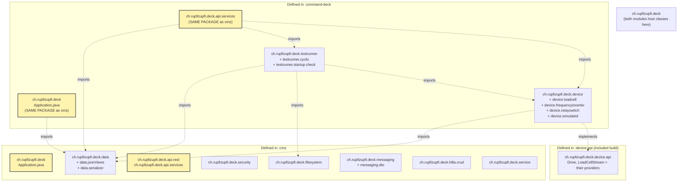

# Shared code strategy

## Purpose
Catalogue exactly which `ch.rupfizupfi.deck.*` sub-packages live in `:cms`, which live in `:command-deck`, and which Java symbols cross the boundary. Mechanism (Gradle `project(':cms')` + Spring component scan) is explained in [`gradle-build.md`](gradle-build.md) and [`spring-boot-setup.md`](spring-boot-setup.md); this document is the **map**.

## Contents

- [Diagram](#diagram)
- [Narrative](#narrative)
  - [Dependency direction](#dependency-direction)
  - [Sub-packages by owner](#sub-packages-by-owner)
  - [Cross-module Java imports (deck → cms)](#cross-module-java-imports-deck--cms)
  - [How a deck `@Service` gets a cms bean](#how-a-deck-service-gets-a-cms-bean)
  - [What is **not** shared](#what-is-not-shared)
  - [Bean pickup summary](#bean-pickup-summary)
- [Where to look in the code](#where-to-look-in-the-code)
- [Decision: cms stays the shared base](#decision-cms-stays-the-shared-base)

## Diagram

Source diagram: [`doc/diagrams/src/package-overlap.mmd`](../../diagrams/src/package-overlap.mmd).

## Narrative

### Dependency direction
There is exactly one declared cross-module link: `command-deck/build.gradle:2` — `implementation project(':cms')`. cms does **not** depend on command-deck: nothing under `cms/` imports `ch.rupfizupfi.deck.testrunner` or `ch.rupfizupfi.deck.device`.

### Sub-packages by owner
| Sub-package | Owner | Notes |
|---|---|---|
| `ch.rupfizupfi.deck` | both | both `Application.java` classes live here |
| `ch.rupfizupfi.deck.api.rest` | cms | 3 `@RestController`s |
| `ch.rupfizupfi.deck.api.services` | both | cms hosts 11 `@BrowserCallable`s, deck hosts 3 (`SuckService`, `TestRunnerService`, `DeviceInfoService`) |
| `ch.rupfizupfi.deck.data` (+ `.jsonViews`, `.serializer`) | cms | 10 `@Entity` classes, all `JpaRepository`s |
| `ch.rupfizupfi.deck.security` | cms | `SecurityConfiguration`, `AuthenticatedUser`, `UserUtils`, `UserDetailsServiceImpl`, the AOP aspect |
| `ch.rupfizupfi.deck.messaging` (+ `.dto`) | cms | `WebSocketConfig` + STOMP DTOs |
| `ch.rupfizupfi.deck.filesystem` | cms | `StorageLocationService`, `CSVStoreService` |
| `ch.rupfizupfi.deck.hilla.crud` | cms | `OwnerDataHelper` + Hilla CRUD plumbing |
| `ch.rupfizupfi.deck.service` | cms | `FileService` |
| `ch.rupfizupfi.deck.device` (+ `.loadcell`, `.frequencyinverter`, `.relayswitch`) | deck | hardware drivers + `DeviceService` |
| `ch.rupfizupfi.deck.testrunner` (+ `.cyclic`, `.startup.check`) | deck | test-execution engine |

Two packages are present in **both** module source trees: `ch.rupfizupfi.deck` and `ch.rupfizupfi.deck.api.services`. The `api/services` classes are disjoint; `Application` exists in both, one loaded per app. Keep this in mind when grepping.

### Cross-module Java imports (deck → cms)
The cms packages `command-deck/src/main/java` imports:

| cms package | Symbols imported by deck | Used in deck classes |
|---|---|---|
| `ch.rupfizupfi.deck.data` | `User`, `UserRepository`, `TestResult`, `TestResultRepository`, `Setting`, `SettingRepository` | `Application`, the `testrunner.program` programs and their registry, `TestRunnerThread`, `TestRunnerFactory`, `TestLogger`, `TestRunnerService`, `DeviceService` |
| `ch.rupfizupfi.deck.filesystem` | `StorageLocationService`, `CSVStoreService` | `TestRunnerFactory`, `MeasurementLoop`, `TestLogger`, `FileSystemCheck` |

Other cms packages (`security`, `messaging`, `hilla.crud`, `api.rest`, `service`) are not imported by deck code but are consumed at runtime via Spring autowiring and Hilla's endpoint registry (`vaadin.allowed-packages`, `application.properties:15`).

### How a deck `@Service` gets a cms bean
Example: `command-deck/.../device/DeviceService.java:3` imports `ch.rupfizupfi.deck.data.SettingRepository` (a `@Service` class in the cms jar). The deck's component scan from `ch.rupfizupfi.deck` registers it, and `DeviceService` receives it by injection. The same applies to `StorageLocationService` ⇒ `TestRunnerFactory`, `CSVStoreService` ⇒ `TestRunnerFactory`, etc.

### What is **not** shared
- The two `Application.java` classes — each module's JAR has its own; the deck's `BOOT-INF/classes` copy wins (see [`spring-boot-setup.md`](spring-boot-setup.md#the-two-classes-have-the-same-fully-qualified-name)).
- Test runners (`testrunner/*`) and device drivers (`device/*`) are deck-only; cms must not import them.
- Frontend code: each module has its own `src/main/frontend/` tree, its own `package.json`, its own Vaadin `generated/` directory, its own `vite.config.ts`. The deck Vite config aliases `'cms'` to `'../cms/src/main/frontend'` (`command-deck/vite.config.ts:30`) so deck TS code can import `useAuth` from the aliased module specifier `cms/util/auth.js` (see `command-deck/src/main/frontend/views/@layout.tsx:5`), but no symbol is duplicated. The deck's `customFileSystemRouterPlugin` merges cms file-routes at build time (`command-deck/customFileSystemRouterPlugin.ts:73`). Frontend strategy details belong to [`dev/frontend/frontend-module-split.md`](../frontend/frontend-module-split.md); from a build-system standpoint each module ships its own React bundle.
- The Flyway migrations (`cms/src/main/resources/db/migration/`) live in cms only, but reach the deck classpath via the `cms-library` jar, so a deck-only boot migrates the shared database too. Mechanics in [`ops/db.md`](../../ops/db.md#schema-migrations).

### Bean pickup summary
Picked up from cms in a `:command-deck` boot, with no deck-side annotations:

- All 10 JPA `@Entity` classes.
- All `JpaRepository` interfaces in `cms/.../data/` (`UserRepository`, `TestResultRepository`, etc.).
- `SecurityConfiguration` — the deck app inherits the cms security chain, including the `/api/**` rules (only the button box anonymous), the `/login` view and the BCrypt password encoder.
- `WebSocketConfig` — STOMP `/topic` broker, the `/status` endpoint and `BrokerInboundGuard`.
- `CheckUserCanOnlyAccessOwnDataAspect` — applies to every `DataWithOwner` access from deck-side `testrunner` code as well.
- All cms `@BrowserCallable` services: cms (11) + deck (3) = 14 in the deck app. Browser-side, the deck React bundle imports cms TS clients via the `'cms'` alias.

## Where to look in the code
- `command-deck/build.gradle:2` — the only declared cross-module dependency.
- `command-deck/src/main/java/ch/rupfizupfi/deck/Application.java` — entry point; package is identical to cms's.
- `command-deck/src/main/java/ch/rupfizupfi/deck/device/DeviceService.java:3` — concrete example of a deck `@Service` autowiring `cms/data/SettingRepository`.
- `command-deck/src/main/java/ch/rupfizupfi/deck/api/services/TestRunnerService.java:3-6` — deck Hilla service consuming cms `TestResult` / `TestResultRepository`.
- `command-deck/src/main/java/ch/rupfizupfi/deck/testrunner/TestRunnerFactory.java:3-8` — peak cross-module fan-in (cms `TestResult` + cms `CSVStoreService` + cms `StorageLocationService` + own `device/loadcell` + own `testrunner/startup/check`).
- `command-deck/src/main/frontend/views/@layout.tsx:5` — frontend cross-import via the `cms` Vite alias.
- `cms/src/main/java/ch/rupfizupfi/deck/security/CheckUserCanOnlyAccessOwnDataAspect.java` — the AOP advice that fires for both modules.

## Decision: cms stays the shared base

A `:shared` module hosting entities, repositories, security, filesystem
and Hilla CRUD plumbing was **declined**. `:command-deck` depends on `:cms`
directly; deck is "cms plus hardware control", and the deployment split
(cloud cms, on-machine deck) doesn't change what code each needs.

Consequences to keep in mind:

- Every cms bean, entity and `@BrowserCallable` service exists in the
  deck app. Access control is the role annotations, not the packaging.
- Anything shared belongs in `:cms`, even if cms itself never calls it.
- `cms-library.jar` (the plain `jar` task output) exists solely so
  `project(':cms')` can be consumed by `:command-deck`. No external
  consumer is known.
