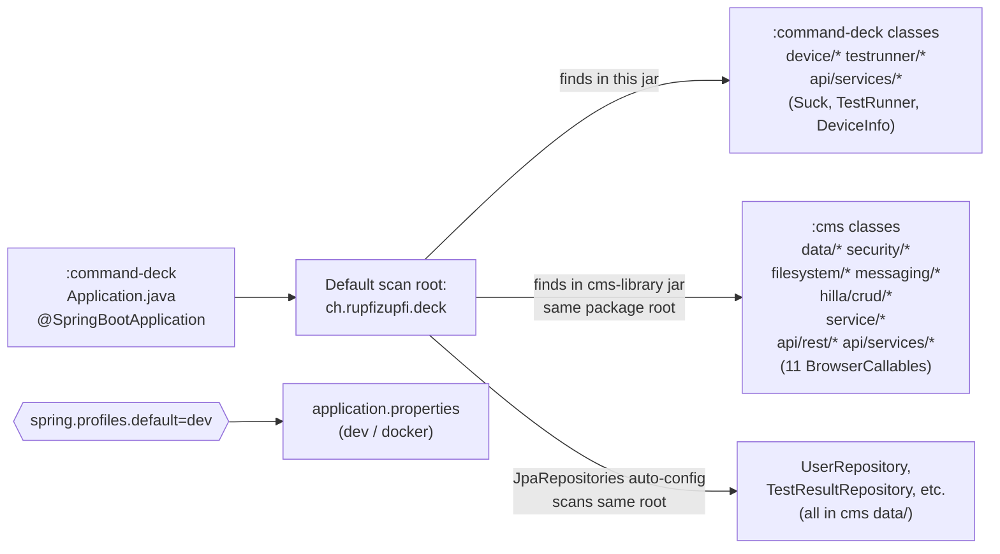

# Spring Boot setup

## Purpose
Document how each module boots, which Spring profiles exist, and how Spring's default component scan stitches `cms` beans into `command-deck` without any explicit `@ComponentScan` / `@EntityScan` / `@EnableJpaRepositories` annotations. Build-time wiring sits in [`gradle-build.md`](gradle-build.md); the cross-module Java-import inventory is in [`shared-code-strategy.md`](shared-code-strategy.md).

## Contents

- [Diagram](#diagram)
- [Narrative](#narrative)
  - [Entry points](#entry-points)
  - [Component scan: how `cms` beans reach `command-deck`](#component-scan-how-cms-beans-reach-command-deck)
  - [`@RestController` paths](#restcontroller-paths)
  - [Profiles](#profiles)
  - [Other shared `application.properties` keys](#other-shared-applicationproperties-keys)
  - [Hardware mode](#hardware-mode)
  - [Startup sequence (text, not a sequence diagram)](#startup-sequence-text-not-a-sequence-diagram)
  - [Docker startup](#docker-startup)
- [Where to look in the code](#where-to-look-in-the-code)

## Diagram

## Narrative

### Entry points
Both modules have a near-identical `Application.java`:

- `cms/src/main/java/ch/rupfizupfi/deck/Application.java` — `@SpringBootApplication @Theme("breaktest-command-deck")` + `@ColorScheme(DARK)`, implements `AppShellConfigurator`. Declares no beans.
- `command-deck/src/main/java/ch/rupfizupfi/deck/Application.java` — same annotations, same theme.

#### The two classes have the same fully-qualified name

Both are `ch.rupfizupfi.deck.Application`. In a `:command-deck` boot, the deck copy sits in `BOOT-INF/classes` and the cms copy inside `BOOT-INF/lib/cms-library.jar`, and the classloader resolves `BOOT-INF/classes` first — so **the cms class is never loaded.**

`:command-deck` ships no migrations of its own; cms's `db/migration/` reaches its classpath via the `cms-library` jar, so a deck-only boot migrates like a cms one ([`ops/db.md`](../../ops/db.md#schema-migrations)).

> Editing `cms/src/main/java/ch/rupfizupfi/deck/Application.java` changes nothing about how the deck app behaves, and a bean added to the deck copy shadows anything the cms copy declares. Don't extend the pattern — put new config in a class with a distinct name per module.

Neither class uses `scanBasePackages`, `@EntityScan`, `@EnableJpaRepositories` or `@ComponentScan`, and no production code does.

### Component scan: how `cms` beans reach `command-deck`
Both `Application` classes live in `ch.rupfizupfi.deck`, so each context scans `ch.rupfizupfi.deck.**`. In a `:command-deck` boot, `cms-library-plain.jar` is on the classpath (`implementation project(':cms')`), so every cms `@Component`, `@Service`, `@Configuration`, `@Aspect`, `@RestController` and `@BrowserCallable` is picked up too:

- `SecurityConfiguration` (cms) protects the deck app's HTTP routes.
- `WebSocketConfig` (cms) registers the `/status` STOMP endpoint and its `BrokerInboundGuard` in the deck context.
- `CheckUserCanOnlyAccessOwnDataAspect` (cms) intercepts every `DataWithOwner` JPA call from deck-side `testrunner/*` code.
- `AuthenticatedUser`, `UserUtils`, `OwnerDataHelper`, `StorageLocationService`, `CSVStoreService`, `FileService`, `UserDetailsServiceImpl` and the Hilla `CrudRepositoryService<...>` machinery are all autowired into deck services without any extra wiring.
- All 11 cms `@BrowserCallable` services are exposed alongside the deck's own 3 — **14** in the deck app.

Entity and repository scanning use the same root, so every `data/` entity and repository is picked up in both contexts.

### `@RestController` paths
The three controllers (`ControllerEndpoint`, `DownloadResults`, `FileEndpoint`) live in `cms/.../api/rest/`. Both apps register them. `application.properties` line 18 sets `vaadin.exclude-urls=/api/**` so MVC, not Vaadin, serves `/api/*`. The full `@RequestMapping` path list is in [`dev/backend/hilla-services.md`](../backend/hilla-services.md).

### Profiles
There are exactly two profiles; each module carries its own copy of the files with the same settings (comments differ).

| Profile | DB | Port | TLS | Flags |
|---|---|---|---|---|
| `dev` (default via `spring.profiles.default=dev`) | H2 file at `${DECK_H2_DIR:./.data}/deck`, `MODE=PostgreSQL` | `${PORT:8080}` | no | `spring.h2.console.enabled=true`, `ddl-auto=validate`, `vaadin.devmode.devTools.enabled=true`, `logging.level.web=DEBUG` |
| `docker` | PostgreSQL `jdbc:postgresql://db:5432/rupfizupfi` (user `rupfizupfi`, pwd `${DB_PASSWORD}`) | `${PORT:443}` | yes (PKCS12 `/home/appuser/keystore/rupfizupfi.p12`) | `ddl-auto=validate` |

The shared-by-default `application.properties` (line 1: `spring.profiles.default=dev`) selects `dev` whenever `SPRING_PROFILES_ACTIVE` is unset; the docker compose file sets `SPRING_PROFILES_ACTIVE=docker` for both server services.

Both modules' `bootRun` point `DECK_H2_DIR` at the repo's `.data/`, so they share one H2 file; run one at a time. `:command-deck:bootRun` already serves the cms UI routes via the route merge plugin.

### Other shared `application.properties` keys
Both modules' base `application.properties` files (cms lines 1-35) carry the same settings, kept in sync by hand (only comments differ; command-deck adds `device.relay.port-description=CH9102` at the end):

- `spring.profiles.default=dev`
- `vaadin.allowed-packages=com.vaadin,org.vaadin,ch.rupfizupfi.deck`
- `vaadin.exclude-urls=/api/**`
- `vaadin.devmode.devTools.enabled=false` (the dev profile re-enables it).
- `vaadin.launch-browser=true`
- `vaadin.analytics.enabled=false`
- `spring.devtools.restart.additional-exclude=dev/hilla/openapi.json` — workaround for hilla #842.
- `spring.flyway.baseline-on-migrate=true`, `spring.flyway.baseline-version=1` — adopt pre-Flyway databases ([`ops/db.md`](../../ops/db.md#schema-migrations)).
- `server.servlet.session.cookie.same-site=lax` — keeps the session cookie off cross-site POSTs, behind the CSRF token ([`dev/backend/security-and-tenancy.md`](../backend/security-and-tenancy.md#csrf-cors-multipart)).
- `deck.hardware.mode=real` — see below. Present in **both** modules' files to keep them in sync; only `:command-deck` reads it.

Circular bean references stay at Boot's default, off: a `BeanCurrentlyInCreationException` is a cycle to break (constructor redesign, `ObjectProvider`), never a reason to set `spring.main.allow-circular-references`. Both modules' `ApplicationContextTest` and `DriverPluginBootTest` (real mode) boot under it.

### Hardware mode

`deck.hardware.mode` (`real` | `simulated`, base default `real`) selects how the deck reaches the machine, and `HardwareModeCheck` enforces it. The `dev` profile sets `simulated`. `docker` sets it for neither deployment that uses that profile, because they differ on exactly this axis: the deck container declares `DECK_HARDWARE_MODE=simulated` (it is the tests-and-simulations deployment) and the native bench declares `real` via `script/run-bench.ps1`. Left unset, the base default `real` is the fail-safe direction: a deployment that forgot to declare a mode refuses to start without drivers rather than quietly simulating.

**Simulation is allowlisted, not blocklisted**: it is permitted only when every effective profile is in `SIMULATION_PROFILES` (`dev`, `docker`), so any other profile — and any that does not exist yet — refuses. `containsAll` over the *whole* active set separates the two `docker` deployments: a bench run is `[bench, docker]` and `bench` is not on the list, so the container may simulate and the bench may not. `HardwareModeCheckTest` pins both directions, including that adding `bench` to the allowlist fails.

Because `spring.profiles.default=dev`, an unset `SPRING_PROFILES_ACTIVE` resolves to the safe state.

Three properties of the check matter:

- **It is a `BeanFactoryPostProcessor`.** It runs before any singleton is instantiated, so it can report "`usbmodbus.jar` is missing" instead of letting `DeviceService`'s constructor fail with a `NoSuchBeanDefinitionException` naming an interface. It also matches bean types with `allowEagerInit=false`, so the check itself never opens a USB device.
- **It refuses `simulated` outside the permitted profiles, before the datasource is touched.** The refusal never depends on a reachable Postgres. `getActiveProfiles()` returns empty rather than the defaults, so the check falls back to `getDefaultProfiles()`; otherwise an unconfigured boot would present an empty set, which any allowlist trivially contains.
- **It stands down when `spring.aot.processing` is set.** `hillaGenerate` boots a Spring AOT context purely to discover `@BrowserCallable` classes; without the exemption that context refuses to start and the *build* starts depending on the vendor jars, defeating their [runtime plugin wiring](gradle-build.md#driver-plugins-loaderpath-not-the-classpath). Every build needs this: drivers arrive over `loader.path`, so a build context never has a provider bean.

There is no fallback in either direction. Rationale: [`dev/backend/device-api.md`](../backend/device-api.md#startup-contract).

### Startup sequence (text, not a sequence diagram)
1. `gradle :MODULE:bootRun` → JVM starts `Application.main`.
2. Spring loads `application.properties`, then `application-dev.properties` (or `-docker`), populating `Environment`.
   In `:command-deck`, `HardwareModeCheck` runs here — before any bean is created — and aborts the boot if the selected `deck.hardware.mode` cannot be served.
3. Flyway migrates the schema (baselining a pre-Flyway one), then Hibernate boots and validates the entities against it.
4. Vaadin scans `vaadin.allowed-packages` for `@Route`, `@BrowserCallable`, `AppShellConfigurator`, etc., and exposes the React bundle at the servlet root.
5. `WebSocketConfig` registers the `/status` STOMP endpoint and guards the client inbound channel.
6. `SecurityConfiguration`'s `SecurityFilterChain` bean registers the HTTP filters, with defaults from `VaadinSecurityConfigurer`. Only `/api/ControllerEndpoint/**` is `permitAll()`; the file and download controllers need a session — see [`dev/backend/security-and-tenancy.md`](../backend/security-and-tenancy.md).
7. Application is ready to serve; the `ApplicationRunner`s (`DevUserSeeder`, `InitialAdminBootstrap`) seed accounts.

In `:command-deck`, `DeviceService` builds the load cell and frequency inverter from their injected providers ([`hardware-integration.md`](../backend/hardware-integration.md)).

### Docker startup
Both images share one entrypoint that unwraps the DB-password secret and
self-signs a TLS keystore before `exec java -jar`, with
`SPRING_PROFILES_ACTIVE=docker` already set by compose. Details:
[`ops/docker-images.md`](../../ops/docker-images.md).

## Where to look in the code
- `cms/src/main/java/ch/rupfizupfi/deck/Application.java`
- `command-deck/src/main/java/ch/rupfizupfi/deck/Application.java`
- `cms/src/main/java/ch/rupfizupfi/deck/security/SecurityConfiguration.java:16-45`
- `cms/src/main/java/ch/rupfizupfi/deck/messaging/WebSocketConfig.java:10-29`
- `cms/src/main/resources/application.properties:1-35`, `application-dev.properties:1-17`, `application-docker.properties:1-36`
- `command-deck/src/main/resources/application*.properties` — same keys and values as cms's for every shared setting (comments differ; `application.properties` adds `device.relay.port-description`).
- `cms/src/main/resources/db/migration/` — schema and seed migrations, the only ones in the repo.
- `cms/src/docker/bin/startup.sh` — used by both Docker images.
- Profile table, expanded with deployment context: [`ops/docker-and-profiles.md`](../../ops/docker-and-profiles.md) and [`ops/db.md`](../../ops/db.md).
- Annotation-by-annotation breakdowns: `@BrowserCallable` and `@RestController` in [`dev/backend/hilla-services.md`](../backend/hilla-services.md), `@Entity` in [`dev/backend/persistence-model.md`](../backend/persistence-model.md), `@Configuration` / `@Aspect` in [`dev/backend/security-and-tenancy.md`](../backend/security-and-tenancy.md).
