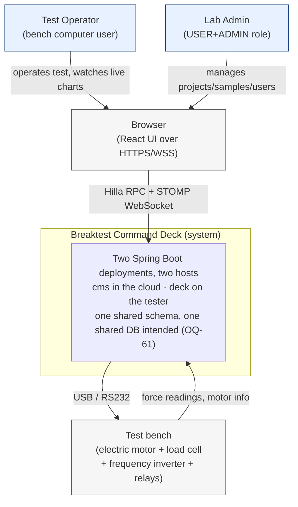
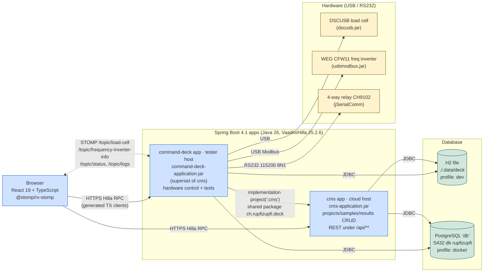

# System architecture

C4-style high-level view. Detail per layer lives in
[`dev/modules/`](../modules/), [`dev/backend/`](../backend/) and
[`dev/frontend/`](../frontend/).

## Contents

- [Context](#context)
- [Containers](#containers)
- [Reading guide](#reading-guide)
- [Fresh-clone quickstart](#fresh-clone-quickstart)
- [Where to look in the code](#where-to-look-in-the-code)

## Context

Who talks to the system, what's outside its trust boundary.



Source: [`doc/diagrams/src/c4-context.mmd`](../../diagrams/src/c4-context.mmd).

## Containers

What's deployed, what runs where. **`cms` is deployed to a cloud host;
`command-deck` runs on the machine physically wired to the test bench.**
Both use the `docker` Spring profile and both are meant to talk to the
same cloud Postgres — see
[`ops/docker-and-profiles.md`](../../ops/docker-and-profiles.md) for
the topology and the one gap still open (OQ-61).



Source: [`doc/diagrams/src/c4-container.mmd`](../../diagrams/src/c4-container.mmd).

## Reading guide

| If you want to know... | Go to |
|---|---|
| Why two Spring Boot apps share one DB | [`dev/modules/module-layout.md`](../modules/module-layout.md) |
| What `command-deck` reuses from `cms` | [`dev/modules/shared-code-strategy.md`](../modules/shared-code-strategy.md) |
| How a Java method becomes a TypeScript call | [`dev/frontend/hilla-generated-layer.md`](../frontend/hilla-generated-layer.md) |
| How a sensor reading reaches a chart | [`dev/frontend/state-and-realtime.md`](../frontend/state-and-realtime.md) |
| Schema and entities | [`dev/backend/persistence-model.md`](../backend/persistence-model.md) |
| Hardware drivers | [`dev/backend/hardware-integration.md`](../backend/hardware-integration.md) |
| Test lifecycle | [`dev/backend/test-execution-engine.md`](../backend/test-execution-engine.md) |
| Build outputs | [`dev/modules/gradle-build.md`](../modules/gradle-build.md) |
| Docker deployment | [`ops/docker-and-profiles.md`](../../ops/docker-and-profiles.md) |

## Fresh-clone quickstart

Minimum to get the system running locally on the `dev` profile:

```bash
git clone <repo>
cd breaktest-command-deck

# Build everything. Requires JDK 26 (Gradle toolchain pins languageVersion 26).
./gradlew build

# Either module migrates and seeds the H2 file — the migrations reach deck via the cms jar.
./gradlew :command-deck:bootRun
# or
./gradlew :cms:bootRun
```

Run **one at a time**: both open the same H2 file
(`./.data/deck.mv.db`) exclusively.

A fresh clone builds without the driver jars and dev needs none —
`application-dev.properties` runs `deck.hardware.mode=simulated`. Driving real
hardware from a dev machine means putting both jars in `drivers/` and running
`bootRun --args='--deck.hardware.mode=real'`. `usbmodbus.jar` is
licence-restricted (it bundles vendor jars) and built in-house from the sibling
repo `../driver/usbmodbus`. No build or image carries either jar — see
[`dev/backend/driver-jars.md`](../backend/driver-jars.md).

Then open <http://localhost:8080>. Default users, seeded by `DevUserSeeder` under `dev` only: `user`/`user` and `admin`/`admin`. The H2 console lives at `/h2-console` (URL `jdbc:h2:file:<repo>/.data/deck`, user `sa`, no password — [`ops/db.md`](../../ops/db.md#dev--h2-file)).

For Docker: [`ops/docker-and-profiles.md`](../../ops/docker-and-profiles.md). For "it broke": [`ops/runbook.md`](../../ops/runbook.md).

## Where to look in the code

| Concern | File |
|---|---|
| Gradle modules | `settings.gradle`, `build.gradle`, `cms/build.gradle`, `command-deck/build.gradle` |
| Cross-module dep | `command-deck/build.gradle:2` (`implementation project(':cms')`) |
| Profiles | `cms/src/main/resources/application{,-dev,-docker}.properties` (and command-deck copies with the same settings; comments differ, and command-deck adds `device.relay.port-description`) |
| Compose | `docker/docker-compose.yaml`, `docker/.env.example` (copy to the gitignored `docker/.env`) |
| Driver plugin wiring | `command-deck/build.gradle` (the `drivers/` `developmentOnly` tree, `driverPluginTest`, the `PropertiesLauncher` manifest), `script/run-bench.ps1` (`LOADER_PATH`); both jars gitignored, no image carries one |
