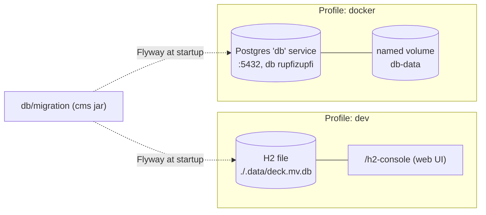

# Database

## Purpose

How data is stored, where, and how to move it between environments. The
schema is documented in
[`dev/backend/persistence-model.md`](../dev/backend/persistence-model.md);
this page is purely operational.

## Contents

- [Diagram](#diagram)
- [Narrative](#narrative)
  - [Schema migrations](#schema-migrations)
  - [Adding a migration](#adding-a-migration)
  - [Which database each deployment uses](#which-database-each-deployment-uses)
  - [Dev — H2 file](#dev--h2-file)
  - [Docker — PostgreSQL](#docker--postgresql)
  - [Seed data](#seed-data)
  - [Backup / restore (Postgres, docker profile)](#backup--restore-postgres-docker-profile)
  - [Resetting the dev DB](#resetting-the-dev-db)
- [Where to look in the code](#where-to-look-in-the-code)
- [Known limits](#known-limits)

## Diagram



## Narrative

### Schema migrations

Flyway owns the schema: versioned scripts in
`cms/src/main/resources/db/migration/`, applied at startup. Hibernate only
checks the result — `spring.jpa.hibernate.ddl-auto=validate` in both profiles
of both modules — and a mismatch fails startup. Entity catalogue:
[`persistence-model.md`](../dev/backend/persistence-model.md).

| Script | Does |
|---|---|
| `V1__baseline.sql` | The schema the entities define, generated by Hibernate (PostgreSQLDialect). Enum columns are plain `varchar`, no CHECK of their constants — a new `RunStatus` or `Role` needs no migration. |
| `V2__reference_data.sql` | Reference rows, see [Seed data](#seed-data). |
| `V3__enum_columns_as_plain_varchar.sql` | Converges databases `ddl-auto` built: drops the frozen enum CHECKs (Postgres) and native `ENUM` columns (H2). No-op after V1. |
| `V4__customer_owner.sql` | Adds `customer.owner_id` (FK to `application_user`) and backfills it: a customer gets the owner of its projects when every referencing project has the same non-null owner, otherwise null (shared) — as does a customer no project references. Pinned on both databases by `CustomerOwnerMigrationTest`. |

* **One script set, two databases.** Scripts must run on PostgreSQL and on H2
  in `MODE=PostgreSQL` (the dev URL). `DATABASE_TO_LOWER` stays off: H2 cannot
  open a file created with its default upper-case identifiers under it.
* **Whichever app boots first migrates.** command-deck carries the same
  scripts through the `cms-library` jar; Flyway's history-table lock
  serializes simultaneous boots and the second finds the schema current.
* **Version skew between cms and bench.** A newer app migrates the shared
  database forward; an older one still starts (Flyway ignores migrations it
  does not know) as long as its entities still validate. A migration that
  drops or renames a column the older build maps stops that build — upgrade
  both.
* **Databases older than Flyway are adopted, not rebuilt.**
  `spring.flyway.baseline-on-migrate=true` + `baseline-version=1` (both
  `application.properties`): a non-empty schema with no
  `flyway_schema_history` is recorded as V1 without running it, then V2
  onwards apply. An empty one runs V1.

### Adding a migration

1. Change the entity.
2. Add `V<next>__<what>.sql` beside the others. Never edit an applied
   script: Flyway checks its checksum and fails startup.
3. Keep it portable (see above). For Hibernate's DDL of the change, run a
   throwaway boot with `jakarta.persistence.schema-generation.scripts.action=create`,
   `…create-target=<file>` and `hibernate.dialect=PostgreSQLDialect`, and diff
   the script against V1 plus later migrations.
4. `./gradlew :cms:test :command-deck:test` — the context tests migrate an
   empty H2 and validate, `TestResultPersistenceTest` does the same on
   Postgres (Docker).

### Which database each deployment uses

`cms` runs in the cloud and `deck` runs on the tester, but they are meant
to share **one** Postgres in the cloud — the tester writes results
straight into the authoritative dataset. `application-docker.properties`
reads `${DB_URL:...}`, defaulting to the Compose-local `db` service; pointing
the deck at the cloud host is OQ-61. See
[`docker-and-profiles.md`](docker-and-profiles.md) for the topology.

### Dev — H2 file

Configured by `cms/src/main/resources/application-dev.properties:11`:

```
spring.datasource.url=jdbc:h2:file:${DECK_H2_DIR:./.data}/deck;MODE=PostgreSQL;DEFAULT_NULL_ORDERING=HIGH
spring.datasource.username=sa
spring.datasource.password=
spring.h2.console.enabled=true
```

* Both modules' `bootRun` set `DECK_H2_DIR` to `<repo>/.data` (not
  `workingDir`, which would break Vaadin's `@Theme` lookup), so
  `.data/deck.mv.db` at the repo root is the one dev database whichever
  module runs — `:cms` and `:command-deck` share one dataset.
* A launch outside `bootRun` falls back to `./.data` under the working
  directory; a `.data/` inside a module directory is such a stray copy, not
  the shared database.
* Dev `settings.json` resolves against the working directory
  (`SettingRepository`, `user.dir`) — the module directory under `bootRun`.
  Gitignored; a default file is written on first read.
* H2 console: `http://localhost:8080/h2-console`. JDBC URL
  `jdbc:h2:file:<repo>/.data/deck` (the absolute `DECK_H2_DIR` path),
  user `sa`, no password.
* H2 holds an exclusive lock on the file: only one Spring Boot process can
  open it at a time. Concurrent `:cms:bootRun` + `:command-deck:bootRun`
  fails with `JdbcSQLNonTransientConnectionException: Database may be
  already in use`. See [`runbook.md`](runbook.md).

### Docker — PostgreSQL

Configured by `cms/src/main/resources/application-docker.properties:6`:

```
spring.datasource.url=${DB_URL:jdbc:postgresql://db:5432/rupfizupfi}
spring.datasource.driverClassName=org.postgresql.Driver
spring.datasource.username=rupfizupfi
spring.datasource.password=${DB_PASSWORD}
```

The Postgres service is described in
[`docker-and-profiles.md`](docker-and-profiles.md). Notable bits:

* Image: `postgres:18.6-trixie`, pinned to what the `cms` production host runs
  (Postgres 18, Debian variant, not alpine: different collations). Minor bumps
  arrive through Dependabot; a major bump needs `pg_upgrade` or a dump/restore of
  `db-data`, so it is a deliberate edit. The cms Testcontainers slice runs
  `postgres:18-alpine` (same major).
* User / DB: both `rupfizupfi`.
* Password: read from the `db-password` Docker secret
  (`../.secrets/db-password.txt`).
* Internal port `5432` is `expose:`'d on the docker network only —
  not published to the host.
* Persistence: named volume `db-data`, mounted at `/var/lib/postgresql` (since 18 the image keeps data in `18/docker` below it; a mount at `/var/lib/postgresql/data` makes the image refuse to start). Survives `docker compose down`.
* Healthcheck: `pg_isready -U rupfizupfi -d rupfizupfi` every 10 s; the app services
  `depends_on: condition: service_healthy`.

### Seed data

`V2__reference_data.sql` inserts reference data only — no accounts, since the
migrations also run under `docker`:

* 11 `gear_type`, 3 `gear_standard`, 8 `material` rows.
* One demo `customer`.

Each insert is `insert … select … where not exists (select 1 from <table>)`
with ids left to the identity column, so a baselined database that already
holds the rows is untouched. Flyway runs it once: a table emptied later is not
refilled.

Accounts come from code: under `dev`, `DevUserSeeder` creates `user`/`user`
(role `USER`) and `admin`/`admin` (roles `USER` + `ADMIN`) in an empty user
table, unless `deck.dev.seed-users=false`; under `docker`,
`InitialAdminBootstrap` creates the first ADMIN from a secret
([`docker-and-profiles.md`](docker-and-profiles.md)).

### Backup / restore (Postgres, docker profile)

These commands assume the docker profile is up.

```bash
# custom-format dump (compressed, supports parallel restore)
docker compose -f docker/docker-compose.yaml exec db \
    pg_dump -U rupfizupfi -d rupfizupfi -Fc > backup.dump

# plain SQL dump
docker compose -f docker/docker-compose.yaml exec db \
    pg_dump -U rupfizupfi -d rupfizupfi > backup.sql

# restore custom-format dump (drops + recreates objects)
docker compose -f docker/docker-compose.yaml exec -T db \
    pg_restore -U rupfizupfi -d rupfizupfi --clean --verbose < backup.dump

# restore plain SQL
docker compose -f docker/docker-compose.yaml exec -T db \
    psql -U rupfizupfi -d rupfizupfi < backup.sql

# single-table export
docker compose -f docker/docker-compose.yaml exec db \
    pg_dump -U rupfizupfi -d rupfizupfi -t <table_name> > <table_name>.sql
```

A local `docker/backup.sql` may exist; it is untracked.

### Resetting the dev DB

```bash
# stop the bootRun process first, then:
rm -rf .data/
./gradlew :cms:bootRun
```

Flyway rebuilds the schema and reference data; `DevUserSeeder` the accounts.

## Where to look in the code

| Concern | File |
|---|---|
| Dev datasource | `cms/src/main/resources/application-dev.properties:11` |
| Dev H2 location (pins the file to the repo root) | `cms/build.gradle`, `command-deck/build.gradle` — `bootRun { environment 'DECK_H2_DIR' }` |
| Docker datasource | `cms/src/main/resources/application-docker.properties:6` |
| Migrations | `cms/src/main/resources/db/migration/` |
| Schema policy | `spring.flyway.*` in both `application.properties`, `ddl-auto=validate` in both profile files |
| Postgres service | `docker/docker-compose.yaml:46` |
| Compose secret -> env -> JDBC URL | `cms/src/docker/bin/startup.sh:26` |

## Known limits

- Databases that `ddl-auto` built still carry `application_user.profile_picture`, which nothing reads; removing it is a migration (OQ-34).
- The `deck` service uses the Compose-local `db`, not the cloud Postgres (OQ-61).
