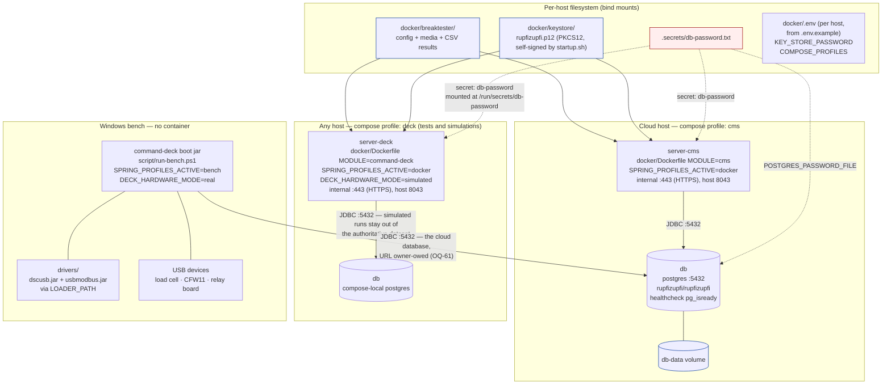

# Docker and Spring profiles

## Purpose

Document the deployment shape (the `cms` profile may run as production on the cloud host): one `docker-compose.yaml`, two
Compose profiles (`cms` and `deck`) that run on **different hosts**, one
Postgres service, and the host-side state (secret file + keystore + bind
mounts) the operator must provide. Neither container drives the machine — the
bench runs natively, [`bench-deployment.md`](bench-deployment.md).

## Contents

- [Deployment topology](#deployment-topology)
- [Diagram — deployment topology](#diagram--deployment-topology)
- [Narrative](#narrative)
  - [One compose file, two profiles](#one-compose-file-two-profiles)
  - [Image build and entrypoint](#image-build-and-entrypoint)
  - [Spring profiles](#spring-profiles)
  - [Volumes & secrets](#volumes--secrets)
  - [Required host preparation](#required-host-preparation)
- [Where to look in the code](#where-to-look-in-the-code)
- [Known limits](#known-limits)

## Deployment topology

The two profiles are two separate deployments, not two roles for one machine:

| Profile | Runs where | Why |
|---|---|---|
| `cms` | Cloud host | Content management: projects, samples, customers, materials, results. Reachable by users who are nowhere near the machine. This profile is a supported **production** deployment and may run as production on the cloud host. |
| `deck` | Any host — a CI box, a laptop, the cloud | Running the deck's own stack for **tests and simulations**: the full application, `deck.hardware.mode=simulated`, no driver plugin anywhere in the image. |

**Neither container touches hardware, and the `deck` container is not the
tester.** Both driver plugins are Windows-only, so a Linux image could not drive
the bench; the image carries no driver, credential or `LOADER_PATH`. The machine
is driven by `command-deck` running **natively on the Windows bench**
([`bench-deployment.md`](bench-deployment.md)), the only deployment that supplies
a driver.

Because the `cms` profile may be running as production, a change to
`docker-compose.yaml`, `startup.sh` or the keystore handling is
production-affecting; the `deck` profile is the safe place to try it first.

A simulated run must **not** write into the authoritative dataset, so the `deck`
service uses the Compose-local `db` by default (`DECK_DB_URL` points it elsewhere,
e.g. a shared test database).

> **OQ-61 belongs to the bench.** It is the deployment that must reach the cloud
> Postgres, and it takes its URL from `script/run-bench.ps1` (`DB_URL`, no local
> fallback). The cloud host is owner-owed.

## Diagram — deployment topology



Source: [`doc/diagrams/src/deployment.mmd`](../diagrams/src/deployment.mmd).

## Narrative

### One compose file, two profiles

`docker/docker-compose.yaml` defines three services:

| Service | Profile | Build | Internal port | Host port | Env |
|---|---|---|---|---|---|
| `server-cms` | `cms` | `docker/Dockerfile`, `MODULE=cms` (context `..`) | 443 | 8043 | `SPRING_PROFILES_ACTIVE=docker`, `KEY_STORE_PASSWORD`, `DB_PASSWORD_FILE=/run/secrets/db-password` |
| `server-deck` | `deck` | `docker/Dockerfile`, `MODULE=command-deck` (context `..`) | 443 | 8043 | the same, plus `DECK_HARDWARE_MODE=simulated` and `DB_URL` |
| `db` | (no profile gate; always on) | image `postgres:18.6-trixie` (pinned to production; `db-data` mounted at `/var/lib/postgresql`; see [`db.md`](db.md)) | 5432 (`expose:`, not published) | — | `POSTGRES_DB=rupfizupfi`, `POSTGRES_USER=rupfizupfi`, `POSTGRES_PASSWORD_FILE=/run/secrets/db-password` |

Both app services wait for `db` to be healthy (`pg_isready`) and carry their own healthcheck: the eclipse-temurin image has neither curl nor wget and the app has no actuator, so it is a bash `/dev/tcp` connect to `127.0.0.1:443` (the HTTPS listener is up; it does not probe login or the database), with a 120 s start period for Flyway and the Vaadin boot.

Activate exactly one per host — `cms` on the cloud host, `deck` wherever tests
and simulations run. Both bind host `8043:443`, so they never share a host:

```bash
docker compose -f docker/docker-compose.yaml --profile deck up -d
```

`COMPOSE_PROFILES` in `docker/.env` picks the profile; `.env.example` sets
`deck`. An `rclone` service for off-tester backup of result files is intended
but not defined; its remote and schedule are unrecorded (OQ-56).

### Image build and entrypoint

**One Dockerfile, parameterised by `MODULE`.** `docker/Dockerfile` is a two-stage
build (`gradle:9.7.1-jdk26-corretto` → `eclipse-temurin:26-jre`); the two services
differ only in that build arg. The shared entrypoint self-signs a TLS keystore and
unwraps the DB-password secret; details in [`docker-images.md`](docker-images.md).

### Spring profiles

Set on the container by the compose file:
`SPRING_PROFILES_ACTIVE=docker`. Local development uses the default
profile (`spring.profiles.default=dev` in `application.properties`).

Both modules carry their own copies of `application.properties`,
`application-dev.properties`, `application-docker.properties`
(same settings, kept in sync by hand; only comments differ, and command-deck's `application.properties` adds `device.relay.port-description`). The
functional differences come from code (e.g. command-deck has the
test-runner singletons; cms has the entity classes) plus the Flyway
migrations only existing in cms. **Decided:** deduplicate — the deck copies go away and the
cms classpath copies become canonical (OQ-4).

| Profile | DB | Port | TLS | Notable extras |
|---|---|---|---|---|
| (default = `dev`) | H2 file `jdbc:h2:file:${DECK_H2_DIR:./.data}/deck` (user `sa`, no password) | `${PORT:8080}` | none | H2 console at `/h2-console`, devtools, `vaadin.devmode.devTools.enabled=true`, `logging.level.web=DEBUG` |
| `docker` | PostgreSQL `${DB_URL:jdbc:postgresql://db:5432/rupfizupfi}` (user `rupfizupfi`, password from secret) | `${PORT:443}` | PKCS12 at `${KEY_STORE_PATH:/home/appuser/keystore/rupfizupfi.p12}`, alias `rupfizupfi`, password `${KEY_STORE_PASSWORD}` | `ddl-auto=validate` |

`bench` is an alias, not a third profile (`spring.profiles.group.bench=docker`):
the two placeholders above plus `DECK_HARDWARE_MODE` are the only per-deployment
differences, so no `application-bench.properties` exists —
[`bench-deployment.md`](bench-deployment.md).

**The alias is also the safety boundary.** `application-docker.properties` sets
`deck.hardware.mode` for neither deployment; each declares `DECK_HARDWARE_MODE`,
and unset, `application.properties` supplies the fail-safe `real`.
`HardwareModeCheck` permits simulation under `docker` but **not** under `bench`,
so the container may simulate and the bench may not
([`spring-boot-setup.md`](../dev/modules/spring-boot-setup.md#hardware-mode)).

See [`db.md`](db.md) for the database angle.

### Volumes & secrets

* **Bind mount `./breaktester:/home/appuser/breaktester`.** Holds the
  user's settings JSON (`settings.json`), uploads, and CSV result files
  written by `MeasurementLoop`, on the host. `~` in the stored paths resolves to `user.home`, which is
  `/home/appuser` in the image.
* **Bind mount `./keystore:/home/appuser/keystore`.** Holds
  `rupfizupfi.p12`. The startup script auto-creates one if missing.
* **Named volume `db-data`.** Postgres data directory. Survives
  `docker compose down`.
* **Secret `db-password`** (mapped to `../.secrets/db-password.txt`). Both
  Postgres (`POSTGRES_PASSWORD_FILE`) and the app server
  (`DB_PASSWORD_FILE`) read from `/run/secrets/db-password`.
**`db-password` is the only secret, and the image build is credential-free** — it
resolves no driver plugin, so it needs neither a registry token nor a build secret.

### Required host preparation

Before `docker compose up -d`, an operator must:

1. Copy `docker/.env.example` to `docker/.env` — per-host and gitignored,
   because it may carry `KEY_STORE_PASSWORD`. The defaults run as they are;
   leave the password unset and `startup.sh` generates one for the
   self-signed keystore and keeps it in `docker/keystore/rupfizupfi.p12.password`.
2. Create `<repo>/.secrets/db-password.txt` containing the desired
   Postgres password. (`.gitignore` excludes `.secrets/`.)
3. Optionally drop a real PKCS12 cert at `docker/keystore/rupfizupfi.p12`
   (set its password as `KEY_STORE_PASSWORD`; an existing keystore with no
   password available fails startup, nothing is guessed). If absent, the startup script
   generates a self-signed one — the normal operating mode, since the
   tester is reached over a trusted local network.
4. Run the profile that matches the host: `cms` in the cloud, `deck` wherever
   tests and simulations run.
5. Set `DECK_ADMIN_PASSWORD` in `docker/.env` (or mount
   `/run/secrets/admin-password`) for the first start. No account is seeded
   outside `dev`: `InitialAdminBootstrap` creates `admin` with that password
   while no ADMIN exists, and with neither set logs a warning and creates
   nobody. A database seeded before this change may still hold
   `admin`/`admin` and `user`/`user`; the bootstrap logs a warning for each
   until its password is changed.

No driver plugins are involved for either profile. The bench has its own list:
[`bench-deployment.md`](bench-deployment.md).

See [`runbook.md`](runbook.md) for failure modes when these preconditions
are skipped.

## Where to look in the code

| Concern | File |
|---|---|
| Compose file | `docker/docker-compose.yaml` |
| Compose env defaults | `docker/.env.example` (tracked); `docker/.env` is the per-host copy, gitignored |
| Both images | `docker/Dockerfile` (one file, `MODULE` build arg) |
| Container entrypoint (shared) | `cms/src/docker/bin/startup.sh` |
| Active-profile property | `cms/src/main/resources/application.properties:1` (`spring.profiles.default=dev`) |
| Docker profile DB / TLS | `cms/src/main/resources/application-docker.properties` (and the command-deck copy, same settings, different comments) |
| Dev profile H2 | `cms/src/main/resources/application-dev.properties` |
| H2 console | enabled in dev via `spring.h2.console.enabled=true` |

## Known limits

- The *bench* does not use the cloud Postgres yet. The URL is externalised (`${DB_URL:...}`) and
  `script/run-bench.ps1` refuses to start without it; the cloud host and what happens to a running
  test when the link drops are owner-owed. Simulated container runs stay on the local db (OQ-61).
- The `rclone` service is not defined in the compose file, so `.env.example` does not activate
  it. Its intended purpose is off-tester backup of result files; target, credentials and schedule
  are unrecorded (OQ-56).
